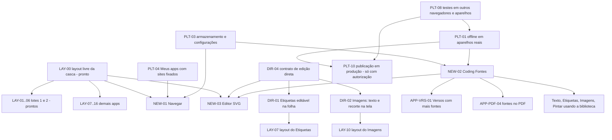

# Planejamento do Coding 2.0

Documento central do que **já está pronto**, do que **está em desenvolvimento**, do que está **planejado** e das **ideias ainda não aprovadas**. Reúne o que foi pedido pelo dono e o que já estava registrado nos documentos, no catálogo e nos Pull Requests do projeto.

> **Este arquivo só documenta.** Nada aqui altera o app, os documentos ou as configurações de quem usa o Coding, e nada aqui autoriza publicar. Regras que sempre valem: veja a [seção 9](#9-regras-permanentes).

Conferido em **01/11/2026** contra o código da branch base de desenvolvimento (`feature/coding-v2-launcher-fixes-sonnet`, já com os PRs #14, #15 e #19 a #23 e #25), o PR aberto #26 (DIR-04) e os documentos listados na [seção 10](#10-fontes-e-como-isto-foi-verificado).

## Sumário
1. [Como ler este documento](#1-como-ler-este-documento)
2. [Situação em uma tela](#2-situação-em-uma-tela)
3. [Concluído](#3-concluído)
4. [Em desenvolvimento](#4-em-desenvolvimento)
5. [Projetos novos planejados (pedidos do dono)](#5-projetos-novos-planejados-pedidos-do-dono)
6. [Pendências por aplicativo](#6-pendências-por-aplicativo)
7. [Plataforma, armazenamento e publicação](#7-plataforma-armazenamento-e-publicação)
8. [Ideias ainda não aprovadas](#8-ideias-ainda-não-aprovadas)
9. [Regras permanentes](#9-regras-permanentes)
10. [Fontes e como isto foi verificado](#10-fontes-e-como-isto-foi-verificado)
11. [Dependências entre os itens](#11-dependências-entre-os-itens)
12. [Inconsistências encontradas nos documentos](#12-inconsistências-encontradas-nos-documentos)

---

## 1. Como ler este documento

**Status** (o que cada palavra significa aqui):

| Status | Significado |
| --- | --- |
| ✅ Concluído | Implementado e verificado (código, testes ou PR mesclado na branch base de desenvolvimento). Não publicado oficialmente. |
| 🛠 Em desenvolvimento | Há PR aberto em rascunho com o trabalho. |
| 📌 Planejado | Pedido explícito do dono. Ainda **não implementado**. |
| 📝 Pendência documentada | Registrada nos documentos, no catálogo ou em PR como "não feito / a fazer". **O dono ainda não decidiu prioridade nem aprovou**; verificado no código que continua pendente. |
| 💡 Ideia | Sugestão registrada, **não aprovada**. Só entra em planejamento depois de o dono aprovar. |
| 🔎 A reverificar | Registrado nos documentos, mas **não foi possível confirmar nesta rodada** (por exemplo, depende de ver a tela ou de aparelho real). |

**Prioridade (proposta)**: sugestão de ordem para o dono confirmar ou mudar. **Não é decisão tomada.** Todas as prioridades deste documento são provisórias; só valem as que o dono confirmar.

| Prioridade | Critério |
| --- | --- |
| P0 | Risco de perda de dados, de segurança ou de afetar a produção. |
| P1 | Pedido direto do dono ou base da qual outros itens dependem. |
| P2 | Melhoria já documentada, de valor claro para quem usa. |
| P3 | Desejável, sem urgência. |

Cada item tem um **ID** (por exemplo `NEW-02`) para ser citado em dependências. A coluna **Origem** diz de onde o item veio; itens sem origem de pedido do dono **não** devem ser tratados como aprovados.

---

## 2. Situação em uma tela

| Área | Situação |
| --- | --- |
| Aplicativos no catálogo | **16**: Etiquetas, Texto, Planilhas, Imagens, Editor PDF, QR / Barras, Sorteio, Racha-conta, Calculadora, Estúdio de Cores, Compactador ZIP, Comparador de Arquivos, Código, Visualizador, Pintar e Versos. Todos com editor real; o catálogo marca todos como *prévia*. |
| Launcher | Versão **2.1.0** na base de desenvolvimento (Início em resumo, Catálogo em vitrine, Meus apps só com os instalados offline, Central de Versões, Ajustes em abas). |
| Publicação | **Nada foi publicado oficialmente.** O Coding 1.0 (arquivos da raiz) continua sendo a versão publicada. Há um PR de release em rascunho (#18) **aguardando autorização do dono**. |
| Em desenvolvimento | `DIR-04` (contrato de edição direta e Etiquetas editável na folha, PR #26). Os lotes 1 e 2 de layouts (#23 e #25) foram mesclados na base em 01/11/2026. |
| Novos projetos pedidos | Coding Navegar, Coding Fontes, Editor SVG, edição direta e reformulação dos demais aplicativos. |
| Limite de validação | Testes automáticos só em **Chromium** (CI). Safari/iOS, Firefox e aparelhos reais **não foram validados**. |

---

## 3. Concluído

Tudo abaixo existe na branch base de desenvolvimento (ou no Coding 1.0, quando indicado) e **não está publicado oficialmente**. Os detalhes finos por recurso estão em [PREVIEW-COMPLETA.md](./PREVIEW-COMPLETA.md) e [ATUALIZACAO-2.0.md](./ATUALIZACAO-2.0.md); aqui fica o resumo para não duplicar.

### 3.1 Plataforma e Launcher
| ID | Entrega | Onde | Evidência |
| --- | --- | --- | --- |
| DONE-01 | Casca única dos editores (`EditorShell`): sidebar ajustável/recolhível no PC, gaveta com alça no celular, teclado virtual e áreas seguras | `src/editors/` | README, `e2e/unified-layout.spec.ts` |
| DONE-02 | Documentos: salvar automático só após alteração, desfazer/refazer, Ctrl+S, proteção contra conflito entre abas, "Salvo" só após a transação terminar | `useDocument.ts`, `docs.ts` | `e2e/persistencia.spec.ts` |
| DONE-03 | Abas de projeto por app (5 visíveis, `+N`, restauração do último) e limites de projetos salvos (Automático/Manual, sem apagar nada) | `src/workspace/` | `e2e/workspace-tabs.spec.ts` |
| DONE-04 | Biblioteca: abrir no app certo, renomear, duplicar, excluir com confirmação, grade/lista, busca, paginação, histórico, prévias sem ler Blobs, importar do Coding antigo (somente leitura) | `src/library/` | `e2e/library*.spec.ts` |
| DONE-05 | Backups: JSON v2 assinado, `.codingpack` binário e ZIP; verificação SHA-256; importação atômica sem sobrescrever | `src/storage/` | `e2e/backup*.spec.ts`, `e2e/codingpack-ui.spec.ts` |
| DONE-06 | Documentos antigos do Coding 1.0: "Converter e abrir" cria documento novo sem alterar o original (conversões aproximadas, ver `APP-*`) | `src/library/` | ATUALIZACAO-2.0.md |
| DONE-07 | Todos os apps sempre disponíveis (sem ativar/desativar); a chave antiga `coding-v2-apps` é ignorada e **nunca apagada** | `LAUNCHER-REFORMULADO.md` | testes do Launcher |
| DONE-08 | Offline por app (instalar, cancelar, atualizar, reparar, desinstalar) com tamanho e SHA-256 reais; **experimental e desligado por padrão** (precisa de build opt-in e domínio dedicado) | `src/offline/`, `public/sw.js` | `e2e/offline.spec.ts` (Chromium, rede cortada) |
| DONE-09 | Versionamento independente por app (versão + compilação + data/hora) e Central de Versões em `/versoes/` | `src/shared/versions*.ts` | `e2e/versoes.spec.ts` |
| DONE-10 | Launcher 2.1.0 (PR #22): Início em resumo, Catálogo em vitrine por categoria, Meus apps só com instalados offline | `src/views/` | `e2e/launcher-reform.spec.ts` |
| DONE-11 | Robô de capturas de tela no CI (desktop, notebook, tablet retrato e paisagem, celular e celular pequeno; claro e escuro) e fluxo de desenvolvimento sem instalação local (PR #21) | `DESENVOLVIMENTO.md`, `scripts/dev/` | workflow de capturas |
| DONE-12 | Menu de contexto e atalhos por aplicativo; temas claro/escuro/automático; acessibilidade (axe) nos specs de app | `src/shared/contextMenu.ts` | `e2e/context-access.spec.ts` |
| DONE-13 | Limites configuráveis de arquivos importados (áudio, vídeo, imagem) em Ajustes → Projetos | `src/workspace/importLimits.ts` | VERSOS.md |

### 3.2 Aplicativos
Versões registradas na Central de Versões na base de desenvolvimento (os seis apps dos lotes 1 e 2 foram mesclados na base em 01/11/2026 pelos PRs #23 e #25). Marca-se o que existe; o que falta está na [seção 6](#6-pendências-por-aplicativo).

| App | Versão | Resumo do que já existe |
| --- | --- | --- |
| Etiquetas | 1.0.1 (1.1.0 no PR #26: edição direta na folha) | Itens (código, descrição, cópias), folha A4 ao vivo, colunas, tipografia, 5 modelos, importação CSV/XLSX com escolha de colunas, colar lista, imprimir/PDF. Correção da rolagem em #20. |
| Texto | 1.0.0 | Formatação completa, tabelas, imagens, links, espaçamento, painel Estrutura, modelos, HTML/TXT/DOCX/PDF. |
| Planilhas | 1.0.0 | Grade com abas, fórmulas em português/inglês, cor de fonte e preenchimento, importar CSV/XLSX, exportar XLSX/CSV, preencher para baixo/direita, ordenar. |
| Imagens | 1.0.0 | Camadas (imagem, texto, retângulo, elipse), recorte por campos numéricos, filtros, Ctrl+V, exportar PNG/JPG/WebP. |
| Editor PDF | 1.0.0 | Juntar, reordenar, girar, extrair, dividir; anotações de texto, destaque, retângulo, elipse, linha, **desenho livre (serve para assinar)** e imagem; PDF exportado conferido nos testes. |
| QR / Barras | 1.0.0 | QR, Code 128, EAN-13/8, UPC-A, Code 39; assistente de conteúdo; vários códigos; aparências salvas; PNG, SVG e folha A4. |
| Sorteio | 1.1.1 | Roleta, números, dados, equipes, listas salvas, histórico conferível. Tela própria no lote 2 (PR #25, mesclado). |
| Racha-conta | 1.1.0 | Pessoas, despesas, divisão igual/porcentagem/valores em centavos, saldos e acertos, CSV/TXT. Tela própria no lote 2 (PR #25, mesclado). |
| Calculadora | 1.1.0 | Básica e Pro, leitor de expressões sem `eval`, variáveis, histórico. Tela própria no lote 1 (PR #23, mesclado). |
| Estúdio de Cores | 1.1.0 | Conversões, harmonias, contraste WCAG, extração de cores de imagem, paleta e exportações. Tela própria no lote 1 (PR #23, mesclado). |
| Compactador ZIP | 1.1.0 | Cria e abre ZIP reais, extrai, testa integridade. Tela própria no lote 1 (PR #23, mesclado). |
| Comparador de Arquivos | 1.1.0 | Diferença linha a linha com destaque por palavra, byte a byte, SHA-256, exporta `.diff`. Tela própria no lote 1 (PR #23, mesclado). |
| Código | 1.0.0 | Projeto com vários arquivos, explorador, realce, busca, quadro isolado com console, importar pasta/ZIP, exportar. |
| Visualizador | 1.0.0 | Imagem, SVG saneado, vídeo, áudio, 3D (STL/OBJ/GLB), PDF e texto. |
| Pintar | 1.0.0 | Camadas, pincéis, balde, formas, **texto e seleção** (mover, copiar, recortar, colar), pixel art, PNG/JPG/WebP. |
| Versos | 1.0.1 | Cenas independentes, textos, estilos, fundos, proporções, música de referência, exportação PNG/ZIP, **arrastar/redimensionar/girar o texto na cena**, 12 fontes OFL embutidas. |

### 3.3 Itens do Coding 1.0 e do ROADMAP antigo já cobertos no 2.0
Itens que apareciam como pendentes em [`ROADMAP.md`](../ROADMAP.md) (que é do Coding 1.0 e **não foi alterado**) e que foram verificados como existentes no 2.0:

| Item do ROADMAP antigo | Situação no 2.0 |
| --- | --- |
| Texto com tabelas e `.docx` | ✅ Tabelas e DOCX (PREVIEW-COMPLETA.md) |
| Modelos | ✅ Todos os apps têm modelos editáveis |
| Backup geral | ✅ Backups JSON, `.codingpack` e ZIP |
| Duplicar documento | ✅ Biblioteca (renomear, duplicar, excluir) |
| Auditoria de 18/10, fases 1 a 6 (confiabilidade, lógica, UX, offline, relatório, extras) | Marcadas como feitas no próprio ROADMAP; o motor de documentos do 2.0 as substitui |

---

## 4. Em desenvolvimento

### 4.1 Pull Requests abertos que são trabalho atual
| PR | Conteúdo | Base | Estado |
| --- | --- | --- | --- |
| **#26** (DIR-04) | **Contrato de edição direta** ([EDICAO-DIRETA.md](./EDICAO-DIRETA.md)) e primeira aplicação: editar código e descrição direto na folha do Etiquetas | base de desenvolvimento | 🛠 Rascunho, CI verde (639 testes e2e), aguardando revisão e autorização para mesclar. |

**Mesclados na base em 01/11/2026 (com autorização do dono):** #24 (este planejamento), #23 (lote 1 de layouts: Calculadora, Cores, ZIP, Comparador) e #25 (lote 2: Sorteio e Racha-conta; abas do Sorteio fixas e legíveis no celular). Antes: #15 (Versos), #19 (Meus apps), #22 (abas do Launcher).

### 4.2 Outros Pull Requests
| PR | O que é | Verificação feita | Decisão pendente |
| --- | --- | --- | --- |
| **#18** | `release: Coding Launcher 2.0.1 no domínio oficial` (libera PWA/offline em `codingtxt.vercel.app`) | Tem 4 commits próprios e está 25 atrás da base. **É um PR de publicação em produção.** | **Só o dono decide.** Não será mesclado nem implantado sem autorização explícita. |
| #12 | Rodada "grande atualização" (a própria branch base de desenvolvimento, comparada com uma base antiga) | Branch já contém tudo; a base atual é a mesma | Fechar ou manter como PR guarda-chuva (dono decide). |
| #1, #3, #9, #10, #11 (✅ **fechados em 01/11/2026**, com comentário de substituição; as branches não foram apagadas) | Etapas anteriores da linha que levou à base atual (Etiquetas 4A, integração de Preview, Prévia completa, offline experimental, layout unificado) | Verificado: **todos os commits já estão contidos na base** (comparação do GitHub: 0 à frente) | Concluído: fechados como substituídos, por autorização do dono. |
| #2, #4, #5, #6, #7 | Ramos paralelos antigos: motor `.codingpack`, interface de backup, logos e visual de loja, editor de Texto real, atualização de Launcher e Biblioteca | Têm commits próprios que **não** estão na base. As funcionalidades equivalentes **existem** na base (`.codingpack` com UI, Texto real, Launcher e Biblioteca) por outros commits | Decidir se fecha; não mesclar sem revisão porque podem conflitar com a base. |

---

## 5. Projetos novos planejados (pedidos do dono)

Todos abaixo são 📌 **Planejados** pedidos em 01/11/2026 e **ainda não foram iniciados**. O que está escrito como "a definir" ou "perguntas em aberto" **não foi decidido**.

### NEW-01 · Coding Navegar (em inglês: Coding Browser)
| Campo | Conteúdo |
| --- | --- |
| Status / prioridade | 📌 Planejado · P2 (proposta) |
| Origem | Pedido do dono (01/11/2026), registrado também no PR #24 |
| Ideia | Navegador integrado ao Coding: **abas**, **favoritos**, **histórico** e **fixação de sites em Meus apps** (cada site fixado aparece lá como se fosse um aplicativo: ícone, nome e um toque para abrir). |
| Identidade visual | Inspirada no **mar, nas ondas e na navegação marítima**. Paleta, ícone, nome das seções e vocabulário: **a definir**. Deve usar a identidade e os componentes compartilhados do Coding. |
| Layout | Próprio para a função (barra de endereço, abas de navegação, favoritos), no PC, tablet e celular, na mesma filosofia dos lotes de layout (`LAY-*`). |
| Dependências | `PLT-04` (Meus apps hoje mostra só instalados offline; precisa de uma seção ou rótulo para sites fixados), `PLT-03` (onde guardar configurações novas, sem mexer em documentos), `LAY-00` (base de layout livre) |
| Perguntas em aberto | <ul><li>**Limite técnico de incorporação:** muitos sites proíbem ser exibidos dentro de outra página (`X-Frame-Options`, `Content-Security-Policy: frame-ancestors`); um iframe não abre todos. Opções: abrir em nova aba para os sites que recusam, ou usar uma visualização web nativa em app instalado. Escolher e avisar claramente quando um site não puder ser incorporado.</li><li>**Privacidade:** histórico e fixados ficam só no aparelho; botão para limpar tudo; `https` por padrão e aviso para `http`; o Coding não guarda sessões nem senhas.</li><li>**Onde guardar os fixados:** nova chave de configuração do Launcher, compatível com o que já está salvo e com teste de migração; sem tocar em projetos, documentos, backups nem no banco legado `coding-db`.</li><li>Como abrir um site fixado: dentro do Navegar ou em nova aba; modo "janela sem barras" quando instalado.</li><li>Se entra no Catálogo como o 17º aplicativo e em qual categoria.</li></ul> |
| Pronto quando | Layout próprio testado em PC, tablet e celular (capturas e e2e), acessibilidade verificada, versão e compilação registradas, migração da nova configuração testada, nenhum dado existente alterado, produção intacta. |

### NEW-02 · Coding Fontes
| Campo | Conteúdo |
| --- | --- |
| Status / prioridade | 📌 Planejado · P1 (proposta: vários itens dependem dele) |
| Origem | Pedido do dono (01/11/2026); já previsto no catálogo (Versos: "Mais fontes pelo futuro Coding Fontes") e em `VERSOS.md` |
| Ideia | **Biblioteca e gerenciamento de fontes** para uso pelos aplicativos do Coding. |
| Já existe (verificado) | <ul><li>Não há sistema global de fontes. Etiquetas, Texto e Imagens usam listas fixas de fontes do sistema (`TEXT_FONTS`, `FONTS` em `labels/model.ts` e `apps/images/model.ts`), que variam conforme o aparelho.</li><li>O **Versos** tem um adaptador local (`src/apps/versos/fonts.ts`) com **ponto de integração pronto**: `registerFontProvider({ id: 'coding-fontes', label, families })`. Provedor registrado aparece no seletor, carrega sem bloquear e entra na exportação.</li><li>O Versos embute **12 famílias sob licença SIL OFL 1.1** (Arimo, Montserrat, Oswald, Bebas Neue, Anton, Playfair Display, Cormorant Garamond, Lora, Great Vibes, Dancing Script, Pacifico, Caveat), com os avisos de direitos autorais em `public/fonts/versos/` e créditos em Ajustes → Sobre.</li><li>O projeto do Versos guarda a **identificação original** da fonte; se faltar no aparelho, só a exibição usa a Arimo, com aviso, e o salvo não é sobrescrito.</li></ul> |
| O que falta | Tudo o que é o app em si: catálogo/biblioteca de fontes, instalar e remover, visualizar, escolher fontes pelos outros apps, empacotamento offline. Nada disso foi iniciado. |
| Dependências | `PLT-01` (offline: fontes são arquivos grandes), `PLT-03` (armazenamento, se houver fontes importadas pela pessoa), consumidores: `APP-TXT-*`, `APP-LAB-*`, `APP-IMG-*`, `APP-PNT-01`, `NEW-03`, Versos |
| Perguntas em aberto | <ul><li>Só fontes com licença livre (como a OFL) ou também fontes importadas pela pessoa? (Fontes proprietárias como Arial **não** são incluídas.)</li><li>Onde ficam os arquivos (pacote do app × armazenamento do aparelho) e como entram no pacote offline.</li><li>Como as fontes vão **dentro** dos arquivos exportados (PDF, DOCX, PNG) e o que acontece quando a fonte falta ao abrir um documento em outro aparelho.</li><li>Como migrar os documentos existentes que guardam nomes de fontes do sistema, sem alterá-los.</li><li>O Editor PDF só anota com Helvetica (caracteres fora do Latin-1 viram `?`): entra no escopo?</li></ul> |

### NEW-03 · Editor SVG
| Campo | Conteúdo |
| --- | --- |
| Status / prioridade | 📌 Planejado · P2 (proposta) |
| Origem | Pedido do dono (01/11/2026) |
| Ideia | **Aplicativo próprio para criar e editar arquivos SVG.** |
| Já existe (verificado) | O **Visualizador** abre SVG **saneado** (`src/apps/viewer/svg.ts`); QR / Barras e o Estúdio de Cores exportam SVG; o **Código** edita texto. **Não existe editor de SVG.** O Imagens e o Pintar trabalham com pixels, não com vetores. |
| Dependências | `NEW-02` (fontes em textos do SVG), `DIR-00` (edição direta no canvas), `LAY-00`, `PLT-05` (saneamento: nunca executar scripts de SVG) |
| Perguntas em aberto | <ul><li>Escopo da primeira versão (formas, caminhos, texto, grupos, camadas, importar/exportar, edição do código ao lado com sincronização).</li><li>Saneamento ao abrir SVG de terceiros e o que fazer com recursos externos.</li><li>Integração: "Abrir no Editor SVG" a partir do Visualizador e do Código.</li><li>Categoria no catálogo (hoje há *Criação e tipografia*).</li></ul> |

### NEW-04 / DIR-00 · Edição direta
| Campo | Conteúdo |
| --- | --- |
| Status / prioridade | 📌 Planejado · P1 (proposta; é um padrão que vários apps reaproveitam) |
| Origem | Pedido do dono (01/11/2026) |
| Ideia | Permitir **editar elementos diretamente na folha, cena, canvas ou prévia, quando fizer sentido**, mantendo o painel de ferramentas **sincronizado**. Exemplo do dono: no **Etiquetas**, editar código e descrição **na própria etiqueta**. |
| Como estão os apps hoje (verificado) | <ul><li>**Já editam direto:** Texto (a folha é editável), Planilhas (células), Editor PDF (anotações se movem e redimensionam na página), **Versos** (texto da cena se move, redimensiona e gira na prévia).</li><li>**Não editam direto:** **Etiquetas** (a prévia da folha não é editável; edição só pelo painel de itens), Imagens (texto e recorte só por painel e campos numéricos).</li><li>Os demais apps não foram avaliados.</li></ul> |
| Candidatos | Cada item abaixo é 📌 apenas no caso do Etiquetas (pedido do dono). **Os outros são 💡 a avaliar caso a caso, sem aprovação.** |

| ID | Candidato | Status | Observação |
| --- | --- | --- | --- |
| DIR-01 | **Etiquetas**: editar código e descrição na própria etiqueta da folha; painel sincronizado | 🛠 Implementado no PR #26 (Etiquetas 1.1.0), aguardando autorização para mesclar | Pedido do dono. A paginação é medida no DOM e cada etiqueta é indivisível: a edição direta não pode quebrar isso. Mobile precisa de um fluxo próprio (toque). |
| DIR-02 | **Imagens**: texto direto na tela e recorte arrastando | 📝 Pendência documentada | Registrado em POST-PREVIEW-BUGFIX.md. |
| DIR-03 | Outras folhas, cenas, canvas e prévias (QR / Barras, Pintar, Calculadora, Racha-conta etc.) | 💡 Ideia | Avaliar se faz sentido app a app. |
| DIR-04 | **Contrato comum de edição na superfície**: seleção, foco, atalhos, desfazer/refazer agrupado, acessibilidade (teclado e leitor de tela), sincronia com o painel, comportamento no toque | 🛠 Contrato escrito e aplicado no PR #26 ([EDICAO-DIRETA.md](./EDICAO-DIRETA.md)); necessário para DIR-01 e `NEW-03` | Definir antes de repetir app a app. |

### LAY-00 a LAY-xx · Reformulação dos aplicativos (layout próprio por função)
| Campo | Conteúdo |
| --- | --- |
| Status / prioridade | Lotes 1 e 2 ✅ concluídos na base; próximos lotes 📌 · P1 (proposta) |
| Origem | Pedido do dono: "cada aplicativo deve ter um layout realmente pensado para sua função, no PC, tablet e celular; podem compartilhar componentes e identidade visual, mas não precisam usar a mesma organização" |
| Base técnica | `LAY-00` ✅ Modo `layout="free"` da casca (`EditorShell`) e `SegTabs` (abas segmentadas acessíveis), mesclados em #23. Cada app define a própria tela; cabeçalho, abas de projeto, avisos e salvamento continuam da casca. |

| ID | Aplicativo | Status | Protagonistas pedidos / organização |
| --- | --- | --- | --- |
| LAY-01 | Calculadora | ✅ #23 mesclado | Visor e teclado protagonistas; histórico/variáveis/arquivo numa coluna (PC) ou gaveta (celular) |
| LAY-02 | Estúdio de Cores | ✅ #23 mesclado | A cor e as paletas; edição ao lado; bancada por abas |
| LAY-03 | Compactador ZIP | ✅ #23 mesclado | Arquivos e operações lado a lado |
| LAY-04 | Comparador de Arquivos | ✅ #23 mesclado | Lados A/B e resultado; no celular, abas Lado A, Lado B e Resultado |
| LAY-05 | Sorteio | ✅ #25 mesclado | Palco (roleta, números, dados, equipes) como protagonista; participantes e histórico ao lado |
| LAY-06 | Racha-conta | ✅ #25 mesclado | Total no alto; pessoas e despesas; acertos e saldos sempre à vista |
| LAY-07 | Etiquetas | 📌 Planejado | Casca própria hoje; combinar com `DIR-01` (folha editável) |
| LAY-08 | Texto | 📌 Planejado | Casca própria hoje. POST-PREVIEW-BUGFIX.md anota que as barras de ferramentas longas no celular rolam bastante |
| LAY-09 | Planilhas | 📌 Planejado | Casca padrão hoje |
| LAY-10 | Imagens | 📌 Planejado | Casca padrão hoje; combinar com `DIR-02` |
| LAY-11 | Editor PDF | 📌 Planejado | Casca padrão hoje |
| LAY-12 | QR / Barras | 📌 Planejado | Casca padrão hoje |
| LAY-13 | Código | 📌 Planejado | Casca padrão hoje |
| LAY-14 | Visualizador | 📌 Planejado | Casca padrão hoje |
| LAY-15 | Pintar | 📌 Planejado | Casca padrão hoje |
| LAY-16 | Versos | 🔎 A reverificar | Já tem layout próprio no celular (prévia em destaque, gaveta com abas); avaliar se precisa de mais |
| LAY-17 | Novos apps (`NEW-01` a `NEW-03`) | 📌 | Nascem com layout próprio |

A ordem e o agrupamento dos próximos lotes (`LAY-07` em diante) **ainda não foram decididos**.

Painel direito de propriedades e modo foco unificados na casca: ver `PLT-06`.

---

## 6. Pendências por aplicativo

Todas 📝 **Pendência documentada**, **verificadas no código em 01/11/2026 como ainda não implementadas**, salvo quando a coluna Status diz outra coisa. Prioridade é proposta. A coluna Origem diz onde o item está registrado (**CAT** = lista `planned` do catálogo, `src/shared/catalog.ts`; **POST** = POST-PREVIEW-BUGFIX.md; **ATU** = ATUALIZACAO-2.0.md).

### 6.1 Etiquetas
| ID | Item | Origem | Status | Prioridade |
| --- | --- | --- | --- | --- |
| APP-LAB-01 | Tamanhos de papel adesivo prontos (Pimaco) | CAT | 📝 (nenhuma referência no código) | P2 |
| APP-LAB-02 | Edição direta na etiqueta | Pedido do dono | 🛠 ver `DIR-01` (PR #26) | P1 |
| APP-LAB-05 | Adicionar pela folha um campo que está vazio (hoje só pelo painel); validar a edição direta em Safari/iOS e aparelhos reais | EDICAO-DIRETA.md §9 | 📝 | P2 |
| APP-LAB-03 | Sem guias nem ajuste magnético (a grade não é um canvas livre) | ATU | 📝 Limitação do modelo atual | P3 |
| APP-LAB-04 | Limites do motor: 200 itens, 500 cópias por item, 2.000 etiquetas | POST | Limitação conhecida (não é bug) | P3 |

### 6.2 Texto
| ID | Item | Origem | Status | Prioridade |
| --- | --- | --- | --- | --- |
| APP-TXT-01 | Cabeçalhos e rodapés | CAT, POST | 📝 (não há no editor; `docx.ts` só trata o que já existe) | P2 |
| APP-TXT-02 | Comentários e revisão | CAT, POST | 📝 | P3 |
| APP-TXT-03 | Células mescladas em tabelas | POST | 📝 | P3 |
| APP-TXT-04 | Numeração de páginas no PDF | POST | 📝 | P2 |
| APP-TXT-05 | PDF do Texto é imagem das folhas (texto não selecionável; "Imprimir → Salvar como PDF" mantém o texto) | POST, ATU | Limitação conhecida | P2 |
| APP-TXT-06 | DOCX: imagens sempre na linha; listas aninhadas viram lista simples | POST | Limitação conhecida | P3 |
| APP-TXT-07 | Símbolos textuais nas ações de tabela (por exemplo `✕ Tabela`), a trocar por ícones SVG | POST | 📝 Confirmado no código | P3 |
| APP-TXT-08 | Fontes do sistema variam por aparelho | — | Ver `NEW-02` | — |

### 6.3 Planilhas
| ID | Item | Origem | Status | Prioridade |
| --- | --- | --- | --- | --- |
| APP-PLN-01 | Gráficos | CAT, POST | 📝 | P2 |
| APP-PLN-02 | Filtros por coluna | CAT, POST | 📝 | P2 |
| APP-PLN-03 | Mesclar células | CAT, POST | 📝 | P3 |
| APP-PLN-04 | Séries automáticas (1, 2, 3…) | POST | 📝 Só existe "Preencher para baixo/direita" (copia) | P3 |
| APP-PLN-05 | Colar fórmulas ajustando referências | POST | 📝 | P3 |
| APP-PLN-06 | Ler formatos e estilos do XLSX importado; `.xls` antigo | POST | 📝 | P3 |
| APP-PLN-07 | Limites: 1.000 linhas × 52 colunas × 20 abas | POST | Limitação conhecida | P3 |

### 6.4 Imagens
| ID | Item | Origem | Status | Prioridade |
| --- | --- | --- | --- | --- |
| APP-IMG-01 | Pincel e borracha | CAT, POST | 📝 Não há no Imagens (o **Pintar** já desenha com pincel e borracha) | P3 |
| APP-IMG-02 | Remover fundo automaticamente | CAT, POST | 📝 | P3 |
| APP-IMG-03 | Recorte arrastando na tela; texto direto na tela | POST | 📝 Ver `DIR-02`. Hoje o recorte é por campos numéricos | P2 |
| APP-IMG-04 | Zoom por pinça | POST | 📝 | P3 |
| APP-IMG-05 | Filtros no Safari antigo (sem `ctx.filter`): desfoque e matiz não aplicados | POST | 🔎 Não verificável sem Safari | P3 |

### 6.5 Editor PDF
| ID | Item | Origem | Status | Prioridade |
| --- | --- | --- | --- | --- |
| APP-PDF-01 | Preencher formulários de PDF | CAT, POST | 📝 Nenhuma referência a formulário no código | P2 |
| APP-PDF-02 | Assinatura desenhada | CAT (aparece como planejada), POST | ✅ **Já existe**: o desenho livre serve para assinar (ATU, `PdfApp.vue`). O item do catálogo está desatualizado (`FIX-02`) | — |
| APP-PDF-03 | Editar o texto que já existe no PDF | POST, ATU | 📝 As anotações são sobreposições | P3 |
| APP-PDF-04 | Anotações só em Helvetica (caracteres fora do Latin-1 viram `?`) | POST | 📝 Confirmado (`engine.ts`); depende de `NEW-02` para fontes | P2 |
| APP-PDF-05 | Opacidade por anotação | ATU | 📝 | P3 |
| APP-PDF-06 | Anotações de imagem (assinaturas) do PDF do 1.0 não são convertidas; "cobrir" vira retângulo | POST | Conversão aproximada, documentada | P3 |

### 6.6 QR / Barras
| ID | Item | Origem | Status | Prioridade |
| --- | --- | --- | --- | --- |
| APP-QRC-01 | Data Matrix e PDF417 | CAT, POST | 📝 Nenhuma referência no código | P3 |
| APP-QRC-02 | Gerar em lote a partir de planilha | CAT, POST | 📝 Hoje há "vários códigos de uma vez" digitados, um por linha | P2 |
| APP-QRC-03 | PDF direto (hoje via "Salvar como PDF" na impressão) | POST | 📝 | P3 |

### 6.7 Sorteio e Racha-conta
| ID | Item | Origem | Status | Prioridade |
| --- | --- | --- | --- | --- |
| APP-SOR-01 | Sorteio com pesos | CAT, POST | 📝 | P3 |
| APP-SOR-02 | Exportar o resultado como imagem | CAT, POST | 📝 | P3 |
| APP-SOR-03 | Roleta com mais de 60 nomes fica com rótulos pequenos | POST | 🔎 Rótulo limitado a 5–13 px no código; não foi reavaliado visualmente | P3 |
| APP-RAC-01 | Várias moedas | CAT, POST | 📝 O modelo só aceita `BRL` | P3 |
| APP-RAC-02 | Compartilhar o resumo por link | CAT, POST | 📝 | P3 |

### 6.8 Calculadora, Estúdio de Cores, Compactador ZIP e Comparador
| ID | Item | Origem | Status | Prioridade |
| --- | --- | --- | --- | --- |
| APP-CAL-01 | Conversão de unidades | CAT | 📝 | P3 |
| APP-CAL-02 | Calculadora financeira e de datas | CAT | 📝 | P3 |
| APP-COR-01 | Paletas a partir de URLs de sites | CAT | 📝 | P3 (exige internet; ver `PLT-02`) |
| APP-COR-02 | Simulação de daltonismo | CAT | 📝 | P3 |
| APP-COR-03 | Conta-gotas da tela só onde o navegador oferece; conversão para CMYK é matemática simples, não perfil de impressão | PREVIEW | Limitação conhecida | P3 |
| APP-ZIP-01 | ZIP com senha (hoje a senha não é suportada) | CAT | 📝 | P3 |
| APP-ZIP-02 | Arrastar e soltar pastas inteiras | CAT | 📝 | P3 |
| APP-CMP-01 | Comparar pastas inteiras | CAT | 📝 | P3 |
| APP-CMP-02 | Mesclar as diferenças | CAT | 📝 | P3 |
| APP-CMP-03 | Acima de 2.000 diferenças o trecho aparece como trocado por inteiro; acima de 50.000 linhas não compara | PREVIEW | Limitação conhecida | P3 |

### 6.9 Código, Visualizador, Pintar e Versos
| ID | Item | Origem | Status | Prioridade |
| --- | --- | --- | --- | --- |
| APP-COD-01 | Módulos `import` entre arquivos | CAT, ATU | 📝 | P2 |
| APP-COD-02 | Destaque do par de parênteses | CAT, ATU | 📝 | P3 |
| APP-COD-03 | Realce desligado acima de 150 mil caracteres; imagens do projeto embutidas como `data:` (8 MB por arquivo, 40 MB no total); arrastar pasta não é suportado | ATU | Limitações conhecidas | P3 |
| APP-VIS-01 | Anotações sobre imagens | CAT | 📝 | P3 |
| APP-VIS-02 | Mais formatos 3D | CAT | 📝 | P3 |
| APP-VIS-03 | "Abrir em…" só de texto para o Código (não de imagens/PDF/Pintar) | ATU | 📝 Pode ligar com `NEW-03` | P3 |
| APP-PNT-01 | Seleção e recorte; texto sobre o desenho | CAT (aparecem como planejados) | ✅ **Já existem** (`PaintApp.vue`: ferramentas Selecionar e Texto; ATU). Item do catálogo desatualizado (`FIX-02`). O texto vira pixels depois de confirmado | — |
| APP-PNT-02 | Sem par de cores frente/fundo; seleção não escala nem gira | ATU | 📝 | P3 |
| APP-VRS-01 | Mais fontes pelo futuro Coding Fontes | CAT | 📌 ver `NEW-02` | P1 |
| APP-VRS-02 | Limites: ZIP de exportação até 200 MB / 4.000 arquivos; PNG acima de ~16,7 MP depende da memória; a sombra não gira com o texto; área de transferência entre projetos espelha até ~1,8 MB | VERSOS.md | Limitações conhecidas | P3 |

---

## 7. Plataforma, armazenamento e publicação

| ID | Item | Origem | Status | Prioridade | Dependências |
| --- | --- | --- | --- | --- | --- |
| PLT-01 | **Offline/PWA em aparelhos reais**: instalação real no celular, Safari/iOS e atualizações em produção nunca foram verificadas; o recurso é experimental e desligado por padrão | README, POST | 📝 | P1 | PLT-08 |
| PLT-02 | Funcionalidades que exigem internet (APIs) para testar **fora** do ambiente de desenvolvimento | ROADMAP 1.0 | 💡 | P3 | — |
| PLT-03 | **Motor de armazenamento — pendências registradas na Fase 3.4:** (1) cópias grandes: o `.codingpack`/ZIP cobre backups acima de 32 MiB; recusar na criação ou backup em partes continua listado; (2) `listCopySummaries` ainda lê o `snapshot.doc` inteiro; (3) `importLegacySnapshotsAtomic` devolve só a contagem; (4) `requestPersistentStorage` devolve só booleano; (5) testes das APIs novas com dados aleatórios e medição de memória/tempo de 32 MiB | FASE3.3, FASE3.4 | 📝 (2), (3) e (4) confirmados no código; (1) e (5) 🔎 | P2 | — |
| PLT-04 | **Meus apps** mostra só os instalados offline; qualquer recurso de "sites fixados" ou de apps não instalados exige decisão de interface | LAUNCHER-REFORMULADO.md | Base pronta; ver `NEW-01` | P1 (para `NEW-01`) | — |
| PLT-05 | Saneamento (HTML do Texto, SVG do Visualizador, quadro isolado do Código) deve virar padrão reutilizável para o Editor SVG e futuras entradas de terceiros | ATU | 💡 Consequência de `NEW-03`, não pedido | P2 | NEW-03 |
| PLT-06 | **Painel direito de propriedades e modo foco unificados na casca**: não implementados; cada app mantém seu painel. O modo `layout="free"` (#23) muda o quadro, mas não cria esse painel | ATU | 📝 | P3 | LAY-00 |
| PLT-07 | Documentos de formatos antigos do 1.0: conversões aproximadas (molduras, balões, adesivos de imagem e alguns filtros do Imagens do 1.0 não são convertidos) | POST | Limitação conhecida | P3 | — |
| PLT-08 | **Testes em outros navegadores e aparelhos reais**: Safari/iOS, Firefox, teclados virtuais reais, simulação real de cota cheia (hoje o teste usa um erro simulado) | README, ATU | 📝 | P1 | — |
| PLT-09 | **Risco de voltar atrás de versão**: abrir e salvar um documento criado com campos novos em um build anterior descarta esses campos; recomendado backup antes de alternar versões | ATU | Aviso conhecido; mitigar com testes de migração em toda mudança de formato | P0 (regra) | — |
| PLT-10 | **Publicação em produção do Coding 2.0 (PR #18, Launcher 2.0.1 com PWA/offline no domínio oficial)** | PR #18 | **Aguarda autorização explícita do dono.** Nada será publicado por conta própria. | P0 | PLT-01, PLT-08 |
| PLT-11 | Datas de lançamento do registro inicial de versões vêm dos commits reais e **devem ser revistas na publicação oficial** | LAUNCHER-REFORMULADO.md | 📝 | P1 (na publicação) | PLT-10 |
| PLT-12 | Páginas de `/versoes/` não fazem parte do pacote offline | LAUNCHER-REFORMULADO.md | Limitação conhecida | P3 | — |
| PLT-13 | Instalar como aplicativo PWA em aparelhos reais; dois apps instalados da mesma origem; não garantir compartilhamento de dados no iOS antes de comprovar | TECHNICAL-PLAN.md | 📝 | P2 | PLT-01 |
| PLT-14 | Sem capturas de tela de aparelhos **reais**; o CI fotografa Chromium em tamanhos de aparelhos | POST | Parcial: ver DONE-11 | P2 | PLT-08 |

---

## 8. Ideias ainda não aprovadas

Estas são 💡 **ideias registradas, sem aprovação**. Vêm da lista "Ideias ainda não aprovadas" do [`ROADMAP.md`](../ROADMAP.md) do Coding 1.0 (arquivo que **não foi alterado**) e de pedidos antigos. Nenhuma está em desenvolvimento.

| ID | Ideia | Origem | Observação da verificação |
| --- | --- | --- | --- |
| IDEA-01 | Salvar modelos próprios (por exemplo "meu padrão" com fontes e tamanhos) | ROADMAP 1.0 | Parcialmente próximo: QR já salva aparências (até 12), Versos guarda estilos no projeto. Não há modelo próprio geral. |
| IDEA-02 | Tamanhos de etiqueta fixos (por exemplo 10 × 5 cm) | ROADMAP 1.0 | Relacionado a `APP-LAB-01` |
| IDEA-03 | Contador "faltam X etiquetas" para completar a última folha | ROADMAP 1.0 | — |
| IDEA-04 | Scanner/OCR (tesseract.js) | ROADMAP 1.0 | Exigiria internet para baixar o motor; testar fora do ambiente de desenvolvimento |
| IDEA-05 | Câmbio (Frankfurter); CEP, CNPJ e feriados (BrasilAPI) | ROADMAP 1.0 | APIs externas; ver `PLT-02` |
| IDEA-06 | Comprimir PDF; juntar fotos em PDF | ROADMAP 1.0 | Juntar PDFs existe; juntar fotos em PDF não foi verificado |
| IDEA-07 | Cartão/convite | ROADMAP 1.0 | — |
| IDEA-08 | QR com formulários prontos | ROADMAP 1.0 | Parcialmente coberto pelo assistente de conteúdo (site, Wi-Fi, e-mail, telefone, SMS, contato) |
| IDEA-09 | Pastas na biblioteca | ROADMAP 1.0 | Não verificado como existente |
| IDEA-10 | Instalação do Coding como app nativo em lojas, sincronização entre aparelhos ou contas | — | **Não consta nos documentos.** O modo offline **não sincroniza** documentos entre aparelhos (README); só backup manual. Listado apenas para deixar claro que **não é um item planejado**. |

---

## 9. Regras permanentes

Valem para tudo neste documento.

- **Produção intacta.** O Coding 1.0 (raiz do repositório) é a versão publicada: não é alterado. `codingtxt.vercel.app` e `coding-seven-sigma.vercel.app` não são mexidos por este trabalho; nada é publicado sem autorização explícita do dono.
- **Merge** só na branch base de desenvolvimento e só com autorização explícita do dono, caso a caso. Nenhuma versão é declarada "publicada oficialmente" sem autorização.
- **Dados das pessoas preservados:** nunca apagar nem reescrever projetos, documentos, backups ou configurações; não abrir o banco legado `coding-db`; mudança de formato de dados precisa ser compatível com o que já está salvo e ter teste de migração.
- **Versões:** ao mexer no código de um app ou do Launcher, registrar uma nova versão em `src/shared/versions-data.ts` (compilação gerada por `scripts/stamp-build.mjs`) e ajustar os testes que fixam versões.
- **Verificação:** o GitHub Actions compila, roda TypeScript, testes unitários e e2e e fotografa as telas em vários aparelhos (`DESENVOLVIMENTO.md`). Testes usam contextos limpos de navegador, nunca dados reais.
- **PRs separados e em rascunho**, com versão e compilação atualizadas.

---

## 10. Fontes e como isto foi verificado

**Documentos lidos:** `README.md` e `ROADMAP.md` (raiz, Coding 1.0, só leitura), `coding-v2/README.md`, `PREVIEW-COMPLETA.md`, `POST-PREVIEW-BUGFIX.md`, `ATUALIZACAO-2.0.md`, `LAUNCHER-REFORMULADO.md`, `VERSOS.md`, `TECHNICAL-PLAN.md`, `FASE2-INTERFACE.md`, `FASE3-DOCUMENTOS.md`, `FASE3.1-SEGURANCA.md`, `FASE3.2-BIBLIOTECA.md`, `FASE3.3-MOTOR.md`, `FASE3.4-BIBLIOTECA.md`, `FASE4-STORAGE.md`, `DESENVOLVIMENTO.md`.

**Pull Requests:** todos os 25 (abertos e fechados). Para os abertos antigos, comparei cada branch com a base de desenvolvimento pelo GitHub (commits à frente/atrás) para saber o que já está contido. Não há *issues* abertas no repositório.

**Código** (branch base mais os lotes 1 e 2 em #23 e #25), conferido item a item antes de classificar como pendente: catálogo e versões registradas; ausência de código para gráficos/filtros/mesclagem/séries (Planilhas), cabeçalho/rodapé/comentários (Texto), formulários (PDF), Data Matrix/PDF417 e lote (QR), pesos e exportação de imagem (Sorteio), moedas (Racha-conta, só `BRL`), senha e pastas (ZIP), comparação de pastas (Comparador), senha de ZIP, daltonismo e conversões (Calculadora/Cores), edição direta na prévia do Etiquetas, tamanhos Pimaco, editor SVG e sistema global de fontes; presença de seleção e texto no Pintar, desenho livre no PDF, arrastar texto no Versos, ponto de integração de fontes (`registerFontProvider`), `.codingpack` com interface e backup em ZIP.

**Não verificado nesta rodada (marcado 🔎):** aparência em Safari/iOS e aparelhos reais; itens de polimento visual que dependem de olhar a tela (rótulos da roleta com mais de 60 nomes, espaçamentos em 600–899 px); filtros do Imagens em Safari antigo; o item (1) e (5) do motor de armazenamento (`PLT-03`).

**Origem dos pedidos novos:** mensagens do dono em 01/11/2026 (Navegar com fixação em Meus apps; ampliação do planejamento com Navegar, Fontes, Editor SVG, edição direta, reformulação e pendências).

---

## 11. Dependências entre os itens

Leitura rápida:
- **Base de layout livre (`LAY-00`)** já existe na base: destrava os lotes seguintes e os apps novos.
- **Contrato de edição direta (`DIR-04`)** vem antes de repetir a edição direta em vários apps.
- **Coding Fontes (`NEW-02`)** é pré-requisito para o Editor SVG tratar texto, para o Versos receber mais fontes e para o Editor PDF sair do limite de Latin-1.
- **Publicação (`PLT-10`)** depende de testes em aparelhos reais e navegadores e da autorização do dono.

---

## 12. Inconsistências encontradas nos documentos

Registradas aqui para serem corrigidas em PRs próprios (nada foi alterado nesta rodada, para não apagar informação existente). Prioridade proposta: P3.

| ID | Onde | Inconsistência | Verificação |
| --- | --- | --- | --- |
| FIX-01 | `coding-v2/README.md`, `PREVIEW-COMPLETA.md`, `LAUNCHER-REFORMULADO.md` | Falam em "doze aplicativos" e "15 apps"; o catálogo atual tem **16** (com o Versos) | Catálogo conferido |
| FIX-02 | `src/shared/catalog.ts` (lista `planned`) | Pintar lista "Seleção e recorte" e "Texto sobre o desenho" como planejados, e o Editor PDF lista "Assinatura desenhada"; os três **já existem** | Código do Pintar e do Editor PDF conferido |
| FIX-03 | `ATUALIZACAO-2.0.md` e `POST-PREVIEW-BUGFIX.md` | Dizem que Etiquetas "não receberam melhorias" e que não há painel direito unificado; o documento é de uma rodada anterior e não menciona #20, #22, #23, #25 | Datas dos PRs |
| FIX-04 | `PREVIEW-COMPLETA.md` | Planilhas: "até 1.000 linhas" no POST e "500 linhas" no README do Coding 1.0 (são versões diferentes) | Os dois são limites de versões diferentes; manter, mas rotular |
| FIX-05 | `coding-v2/README.md` | Seção Offline diz "Preview isolado"; o PR #18 propõe liberá-lo no domínio oficial (não mesclado) | PR #18 |
| FIX-06 | `README.md` raiz (Coding 1.0) | Descreve só o Coding 1.0; é a versão publicada e **não deve ser alterado** | CLAUDE.md do repositório |
